<h1 align="center">Hi there, I'm Bảo Khánh (Blu) 👋</h1>

  <b>QA / Software Tester Intern</b> · Vietnam 🇻🇳 
  <i>Catch bugs early. Make every bug reproducible. Automate the repetitive checks.</i>

  
  
  

---

## 👨‍💻 About Me

- 🎯 **QA / Software Tester Intern** with a solid foundation in Linux, Docker, and CI/CD.
- 🔭 **Currently building:** Postman collections and a Playwright test suite that run in GitHub Actions.
- 🧭 **Interested in:** shift-left testing, observability & logging, automated regression suites.
- 💬 **Ask me about:** API testing with Postman, Dockerized test environments, log analysis on the Linux CLI, basic CI setup.

## 🧪 What I Do

| Area | How I work |
| --- | --- |
| 📝 **Test design** | Turn requirements into clear test cases and checklists, covering boundary values and edge cases. |
| 🔌 **API testing** | Check status codes, response bodies, auth, and error handling with Postman. |
| 🎭 **UI automation** | Automate key user flows and regression checks with Playwright (Python). |
| 🐞 **Bug reporting** | Write reproducible reports: steps, expected vs. actual result, logs, and screenshots. |
| 🐳 **Test environments** | Spin up isolated environments with Docker Compose and dig through logs on Linux. |
| ⚙️ **CI/CD** | Run test suites automatically on every push with GitHub Actions. |

## 🛠️ Tech Stack

**Testing & QA**

**Environments & CI/CD**

**Tools**

## 📊 GitHub Stats

  
  

